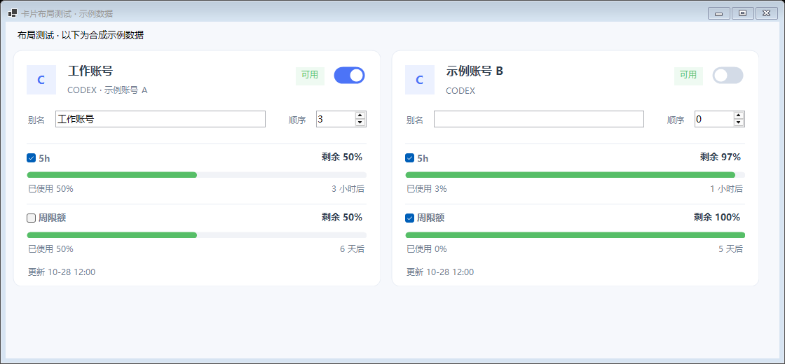

# CPAMP–BrimDeck Bridge

在 BrimDeck 中显示 CPA / CPA-Manager-Plus（CPAMP）的账号额度和用量统计。Windows 桥接程序与独立 Custom 脚本均可使用。

v1.2.0 新增可选的 Codex 官方额度查询，以及无需常驻 Bridge 的 Custom 脚本。额度来源可在“连接设置”切换，旧配置默认继续使用 CPAMP 快照。额度和统计定时独立刷新，保存账号选择后立即读取。

## 不想常驻 Bridge：直接使用 Custom 脚本

从 [Releases](https://github.com/Richard-Nido/CPAMP-BrimDeck-Bridge/releases) 下载并解压，或打开仓库的 [scripts](scripts)。在 BrimDeck“设置 → 配额与统计 → 添加应用”选择 `Custom`，填写下表中对应的站点和密钥，并粘贴整个脚本。

| 功能 | 脚本 | 站点 / 密钥 |
|---|---|---|
| 指定 Codex 账号官方额度 | [BrimDeck-CPA-Direct-Codex.js](scripts/BrimDeck-CPA-Direct-Codex.js) | CPA 本机地址 / CPA 管理密钥；也支持 CPAMP 地址 / CPAMP Admin Key 转发 |
| 今日 / 7 天 Token、费用、请求成功率 | [BrimDeck-CPAMP-Direct-Statistics.js](scripts/BrimDeck-CPAMP-Direct-Statistics.js) | CPAMP 本机地址 / CPAMP Admin Key |
| CPA 原生统计 | [BrimDeck-CPA-Direct-Statistics.js](scripts/BrimDeck-CPA-Direct-Statistics.js) | CPA 本机地址 / CPA 管理密钥；指标由 CPA 版本和实际接口决定 |

CPA 地址通常为 `http://127.0.0.1:8317`，CPAMP 通常为 `http://127.0.0.1:18317`。这些脚本都不使用 `18731` 桥接地址或桥接密钥。

额度脚本顶部的 `QUOTA_SOURCE` 可选 `official`（官方）或 `cpamp`（CPAMP 已有快照，站点须填 CPAMP）。`ACCOUNT` 填指定凭证文件名；邮箱和 workspace 可补充精确限定。也可先运行 Bridge，在“BrimDeck 接入”选择账号并复制自动生成的直连脚本。每次刷新重新获取该账号的 `auth_index`，调用 CPA 的 `/v0/management/api-call`，由 CPA 用 `$TOKEN$` 替换对应账号凭证，请求 `https://chatgpt.com/backend-api/wham/usage`。脚本不下载凭证文件，也不需要粘贴 OAuth Token。

设置完成后可以彻底退出 Bridge。BrimDeck 按自己的刷新设置执行脚本；相关 CPA / CPAMP 数据服务仍须运行。Custom 数据显示为配额行，不能写入 BrimDeck 底部内置 Token / 费用统计区。

## 使用桥接程序

下载 Windows x64 包，双击 `CPAMP-BrimDeck-Bridge.exe`。无需安装 .NET、Python 或 Node。

1. 在“连接设置”填写 CPAMP 本机地址和 Admin Key，选择额度来源并“保存并测试连接”。
2. 在“账号管理”勾选账号、窗口，设置别名与顺序，点“保存账号选择”。
3. 使用“CPAMP 已有额度快照”时，只读取现有数据，不发起官方请求。
4. 使用“CPA 代理查询官方额度”时，仅自动查询已勾选的 Codex 账号；通过 CPAMP 已配置的 CPA 连接转发。其他提供商仍读取 CPAMP 快照。默认每 120 秒刷新，可配置。
5. 在“BrimDeck 接入”复制桥接地址、桥接密钥及原有额度 / 统计脚本。此方式需 Bridge 常驻。

官方查询失败会保留上次成功的官方值并标过期、显示原因；不会静默改用另一来源。无数据时显示未知。账号禁用、删除或身份变化会明确提示。

## 数据含义

- 进度环表示已用比例，主文字表示剩余比例；不以重置时间推算虚假 0% 或 100%。5h、周、月窗口按官方实际时长区分，代码审查及附加额度单独展示。
- CPAMP 模式合并持久化快照与 auth-files 运行时额度，按同账号、同窗口取最新观测；按额度字段的观测时间标记新旧，不把最近读取时间当作官方更新时间。
- Bridge 统计默认按 Windows 时区；独立 CPAMP 统计脚本默认中国标准时间（UTC+8），7 天默认含今天 7 个自然日，可在脚本顶部改为滚动 168 小时。
- CPAMP 金额直接取其定价引擎返回值；缺失字段显示不可用。CPA 原生统计的范围和完整性不能等同于 CPAMP 的历史统计。本机 CPA 8.0.47 不提供完整 `/usage`，脚本明确报告不支持；不降级为局部请求计数。
- BrimDeck 每来源一个折叠环，取该来源最高百分比；最多 7 列。统计来源的百分比表示请求成功率。
- 不消费 CPA 用量队列、不写 CPAMP 数据库、不发起付费模型推理。管理密钥仅保存在本机；发布包不含个人配置。

## 开发与验证

主程序使用 .NET 8 WinForms、Kestrel、HttpClient、Windows DPAPI 和 winsqlite3，没有第三方 NuGet 包。当前实测 CPAMP v1.14.10、CPA v8.0.47、BrimDeck 1.2.1；旧版验证记录保留在历史报告中。

- [中文使用教程](使用教程.md)
- [构建与维护](BUILD.md)
- [实际测试报告](TEST_REPORT.md)
- [源码与兼容调查](docs/SOURCE_INSPECTION.md)
- [第三方声明](THIRD_PARTY_NOTICES.md)

MIT License。反馈问题请勿提交密钥、数据库、OAuth 凭证或私人账号截图。
